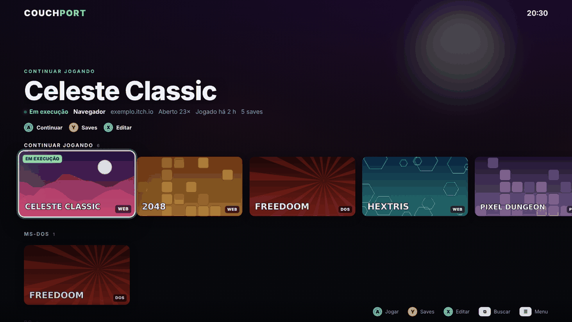
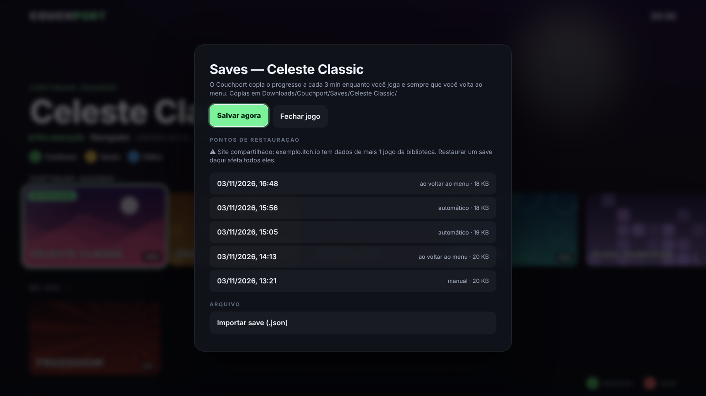
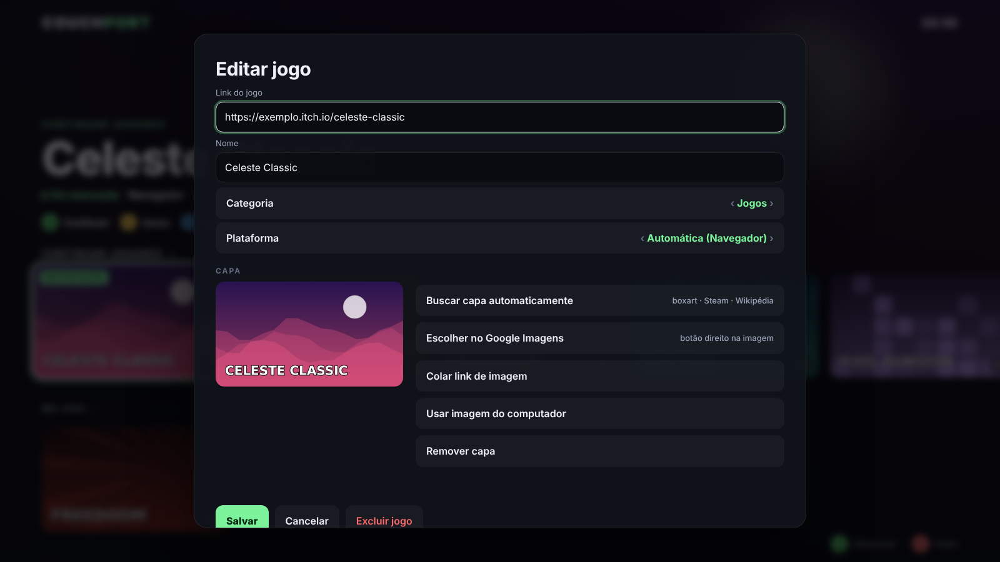

# Couchport

**A console-style launcher for your browser games and web ports.** Navigate with a gamepad, play in fullscreen, jump back to the menu with one button, and let your progress back itself up.

[Português](README.md)



> The interface is currently in Brazilian Portuguese. Translations are welcome.

## Features

- **Gamepad-first**: D-pad/stick to move, A to play, B to go back, Y for saves, X to edit. Keyboard works too. On-screen button prompts follow whatever you're using.
- **Fullscreen, and back to the menu**: each game opens in its own fullscreen window. Hold **SELECT + START**, press **Home/Xbox/PS**, or use **Ctrl+Shift+H** to save and return. The game keeps running in the background, so you can resume it.
- **Grid library**: short rows on the home screen (12 games + "See all"), plus a vertically scrolling grid with one tab per group (LB/RB switch tabs).
- **Original platform**: games are classified (NES, SNES, N64, PS1, PS2, GameCube, Genesis, DOS, PC…) from name tags, Wikidata (earliest release platform), and the libretro boxart sets. Group by platform or category, and override by hand.
- **Real covers**: libretro boxarts, Steam, Wikipedia, and SteamGridDB with a free key. **Never the hosting site's image or icon.** You can also pick one from Google Images (right-click → "Use as cover"), paste a link, or upload a file.
- **Starter pack**: offered on first launch (`extension/starter-pack.json`).
- **Automatic save backups**: whatever the game stores in the browser (localStorage and IndexedDB, which Emscripten ports use) is copied every few minutes and whenever you return to the menu. Copies are organized in `Downloads/Couchport/Saves/<game>/`, with one-click restore points.
- **Game catalogs**: import ready-made lists in Markdown tables, such as a GitHub README. Only the playable-link column ("Play"/"Demo") is used, and the list is fetched live. The [Ultimate Catalog of Web Game Ports](https://github.com/Carter54git/Ultimate-Catalog-Of-Web-Game-Ports) (500+ playable games) is suggested out of the box.
- **Bookmark import**: export your Chrome bookmarks and tick the game folders.
- **Linux launcher** (optional): separate browser profile, WebGPU/Vulkan flags, NVIDIA PRIME offload (hybrid laptops or eGPUs), and the `performance` power profile while it's open.

| Home | Saves | Edit & cover |
|---|---|---|
|  |  |  |

> The covers in the screenshots are original artwork made for the demo.

## Install

Works in any Chromium-based browser (Chrome, Chromium, Brave, Edge) on Linux, Windows, and macOS.

1. Download `couchport-x.y.z.zip` from [Releases](../../releases) and extract it somewhere permanent.
2. Open `chrome://extensions` and turn on **Developer mode**.
3. Click **Load unpacked** and pick the extracted folder.
4. Click the Couchport icon in the toolbar to open the menu.

The extension runs from that folder, so don't move or delete it. To update, replace the files and hit ↻ on the extension card. Your library, covers, and saves are kept.

**Recommended:** use a browser profile just for games, so the extension's broad permission (see below) stays confined to it. The Linux launcher does this for you.

### Linux launcher

```bash
git clone https://github.com/MrWBr/CounchPort.git && cd CounchPort && bash linux/install.sh
```

Configure it in `~/.config/couchport/launcher.conf`. See [`linux/launcher.conf.example`](linux/launcher.conf.example) for `COUCHPORT_BROWSER`, `COUCHPORT_PROFILE`, `COUCHPORT_GPU` (`off`/`webgpu`/`vulkan`), `COUCHPORT_NVIDIA`, and `COUCHPORT_PERFORMANCE`. Load the extension once in that profile through `chrome://extensions`. Recent Google Chrome builds ignore `--load-extension`.

For NVIDIA with Flatpak Chrome, install the GL extension that matches your driver:

```bash
flatpak install flathub org.freedesktop.Platform.GL.nvidia-$(nvidia-smi --query-gpu=driver_version --format=csv,noheader | tr . -)
```

## How saves work

Couchport injects a script into the tabs **it opened** and copies that site's `localStorage` and every IndexedDB database, including binary values (`Uint8Array`, `Blob`, `Date`…). This happens on a timer, when you return to the menu, and on demand. Identical snapshots are skipped.

To restore, Couchport closes the game (backing up its current state first) and opens a special page on the site that **stops loading before any game script runs**, so nothing holds the database open.

**Limits:**
- Cloud, server-side, and cookie saves are not covered.
- Per-site data over ~48 MB is skipped, with a warning. That's usually cached game assets rather than progress.
- Games inside a cross-origin iframe (such as itch.io HTML games) get one save per origin.
- **Games hosted on the same site share storage.** Browsers isolate storage per site, not per game, so restoring one game on a shared domain rolls back every game on that domain. Couchport warns you, and backs up and closes the other open games from that site before restoring.
- Sites that redirect unknown paths can break restore. You still have the `.json` file.

## Permissions & privacy

- **Read and change data on all sites**: needed to back up and restore saves and to detect the gamepad combo. The script runs everywhere, but it only acts in tabs that Couchport opened. Also used to fetch cover images without CORS issues.
- **Tabs, windows, downloads, unlimited storage, context menus, alarms**: fullscreen windows, save copies on disk, covers and restore points, the "Use as cover" menu item, and periodic backups.

External requests: game names go to Wikidata, Wikipedia, Steam's public (unofficial) store search, and, if configured, SteamGridDB. Boxart lists come from the GitHub API (60 requests/hour unauthenticated, cached for 14 days) and images from raw.githubusercontent.com. Game sites are only contacted when you play. The project has no server. Everything stays in your browser.

## Development

No build step and no dependencies. The extension ID is pinned (`gophecbelcdemgikiigfdmihjplabpbc`) through the public key in `manifest.json`.

```bash
pip install playwright
CHROME=/path/to/chromium python3 tests/e2e.py   # Chromium or Chrome for Testing
bash scripts/package.sh                          # dist/couchport-<version>.zip
```

Pushing a `v*` tag publishes the zip to Releases through GitHub Actions.

## Disclaimer

Couchport is only a launcher: **it doesn't include or host any games**. The suggested catalog is maintained by third parties and fetched from its source. Couchport doesn't control or vet the listed sites, and many ports require the original game files. Use it with games you're allowed to play.

## License

[MIT](LICENSE)
