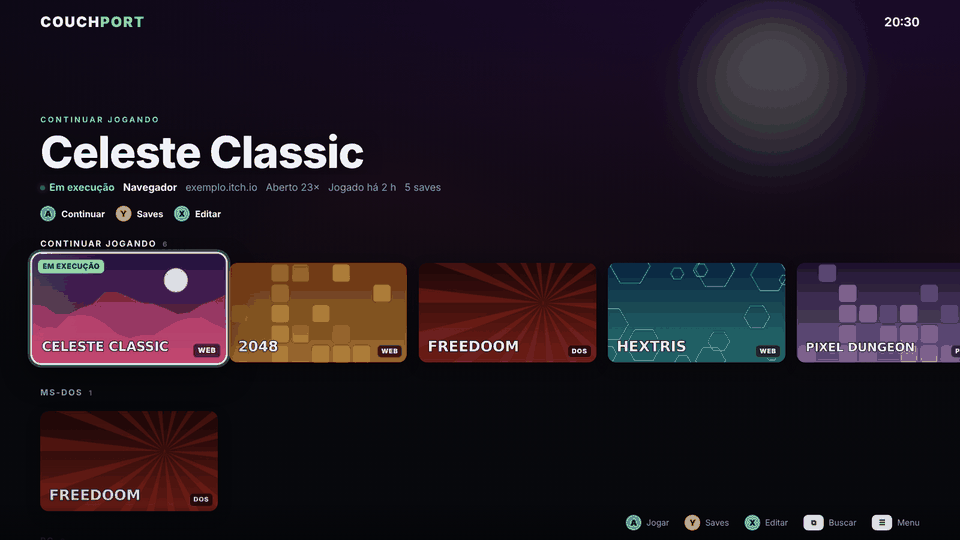
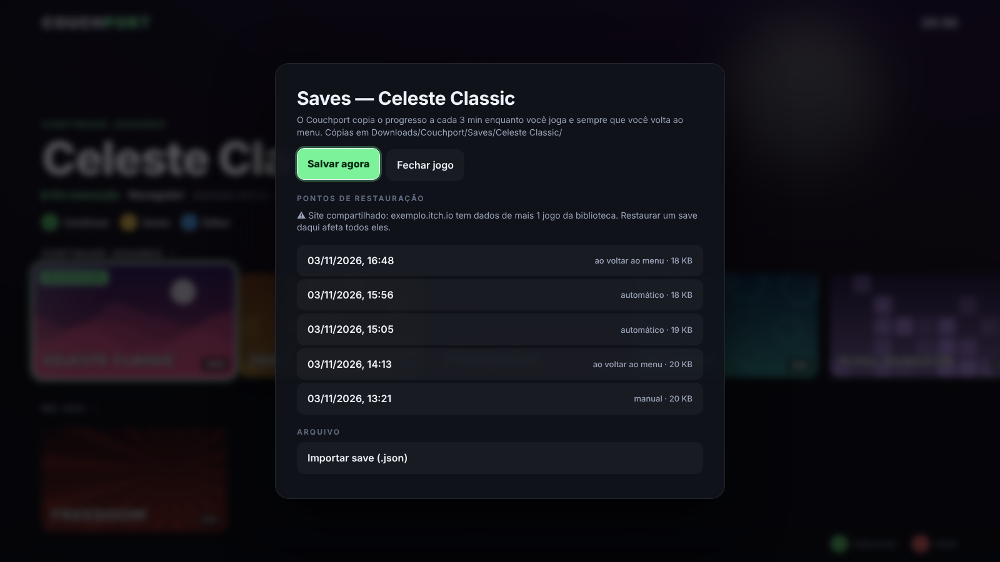
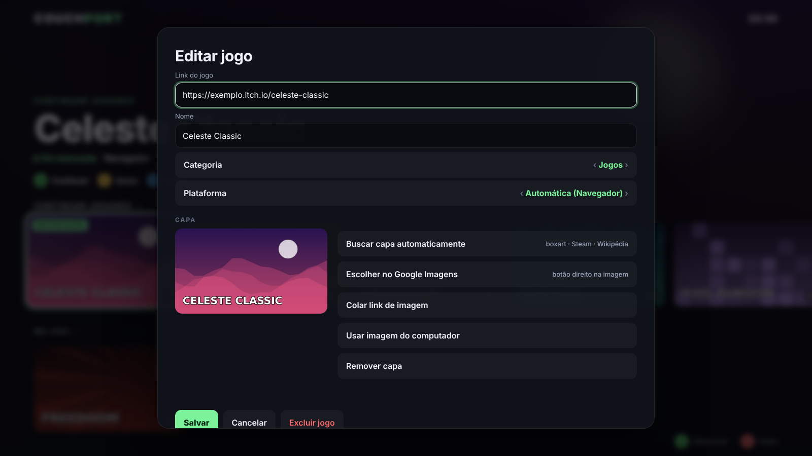
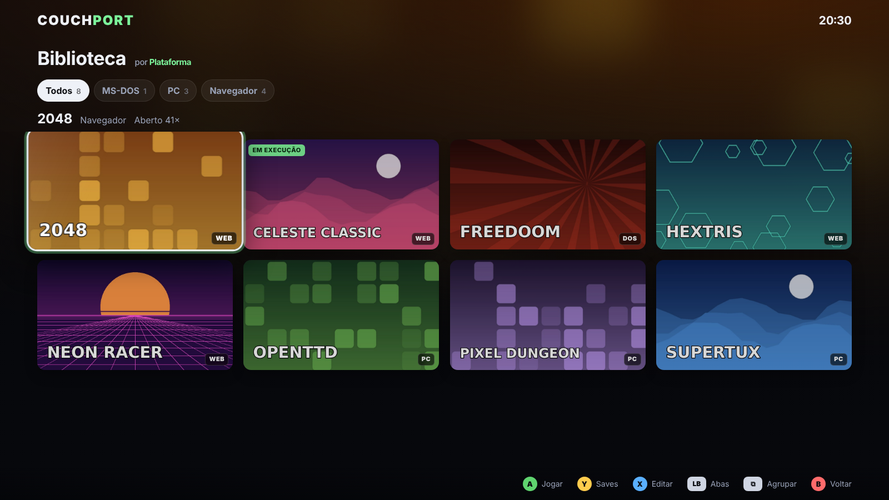

# Couchport

**Um menu estilo console para os seus jogos de navegador e webports.** Navegue com o controle, abra os jogos em tela cheia, volte ao menu com um botão e deixe o progresso ser copiado sozinho.

[English](README.en.md)



## Recursos

- **Feito para controle**: direcional/analógico navega, A joga, B volta, Y abre os saves, X edita. Também funciona só no teclado. Os ícones dos botões na tela mudam conforme o que você está usando.
- **Tela cheia e voltar ao menu**: cada jogo abre na sua própria janela em tela cheia. Segure **SELECT + START**, aperte o botão **Home/Xbox/PS** ou use **Ctrl+Shift+H** para salvar e voltar. O jogo fica em segundo plano, e você continua de onde parou.
- **Biblioteca em grade**: a tela principal mostra fileiras curtas (até 12 jogos + "Ver todos"), e a biblioteca completa é uma grade com rolagem vertical e uma aba por grupo (LB/RB trocam de aba).
- **Plataforma de origem**: cada jogo é classificado (NES, SNES, N64, PlayStation, PS2, GameCube, Mega Drive, DOS, PC…) por etiqueta no nome, pelo Wikidata (a plataforma em que saiu primeiro) e pelo acervo de boxarts do libretro. A biblioteca agrupa por plataforma ou por categoria, e dá para corrigir manualmente.
- **Capas de verdade**: boxarts do [libretro-thumbnails](https://github.com/libretro-thumbnails), Steam, Wikipédia e, com uma chave gratuita, o SteamGridDB. **Nunca usa a imagem ou o ícone do site onde o jogo está hospedado.** Também dá para escolher uma no Google Imagens (botão direito → "Usar como capa"), colar um link ou enviar um arquivo.
- **Pacote inicial**: na primeira abertura, o Couchport oferece uma seleção de jogos para começar (`extension/starter-pack.json`).
- **Backup automático dos saves**: o progresso que o jogo guarda no navegador (localStorage e IndexedDB, onde os webports Emscripten salvam) é copiado a cada poucos minutos e sempre que você volta ao menu. Há uma cópia organizada em `Downloads/Couchport/Saves/<jogo>/` e pontos de restauração com um clique.
- **Catálogos de jogos**: importe listas prontas em tabela Markdown, como o README de um repositório do GitHub. Só a coluna de link jogável ("Play"/"Demo") é usada, e a lista é baixada na hora, então vem sempre atualizada. Já vem sugerido o [Ultimate Catalog of Web Game Ports](https://github.com/Carter54git/Ultimate-Catalog-Of-Web-Game-Ports), com mais de 500 jogos jogáveis.
- **Importa seus favoritos**: exporte os favoritos do Chrome e marque as pastas de jogos.
- **Lançador para Linux** (opcional): abre o navegador num perfil separado, com aceleração WebGPU/Vulkan, PRIME offload para placas NVIDIA (notebook híbrido ou eGPU) e modo desempenho enquanto estiver aberto.

| Tela principal | Saves | Editar e capa |
|---|---|---|
|  |  |  |



> As capas das imagens acima são artes criadas para a demonstração.

## Instalação

Funciona em qualquer navegador baseado em Chromium (Chrome, Chromium, Brave, Edge), em Linux, Windows e macOS.

1. Baixe o `couchport-x.y.z.zip` da página de [Releases](../../releases) e extraia numa pasta que você não vá apagar (ex.: `Documentos/couchport`).
2. Abra `chrome://extensions` e ligue o **Modo do desenvolvedor** (canto superior direito).
3. Clique em **Carregar sem compactação** e escolha a pasta extraída.
4. Clique no ícone do Couchport na barra de extensões para abrir o menu.

O navegador roda a extensão direto dessa pasta, então não mova nem apague a pasta. Para atualizar, substitua os arquivos e clique em ↻ no card da extensão. Biblioteca, capas e saves são preservados.

**Recomendado:** use um perfil do navegador só para jogos. Assim a permissão ampla da extensão (veja abaixo) fica restrita a ele. O lançador de Linux já faz isso.

### Lançador para Linux (opcional)

```bash
git clone https://github.com/MrWBr/CounchPort.git
cd CounchPort
bash linux/install.sh
```

Isso instala o comando `couchport` e um atalho no menu de aplicativos. A configuração fica em `~/.config/couchport/launcher.conf`:

| Variável | Padrão | O que faz |
|---|---|---|
| `COUCHPORT_BROWSER` | `auto` | `google-chrome`, `chromium`, `brave-browser` ou `flatpak:com.google.Chrome` |
| `COUCHPORT_PROFILE` | `~/.config/couchport/profile` | Pasta do perfil de jogos |
| `COUCHPORT_GPU` | `webgpu` | `off`, `webgpu` ou `vulkan` (força ANGLE/Skia sobre Vulkan) |
| `COUCHPORT_NVIDIA` | `0` | `1` ativa o PRIME render offload da NVIDIA |
| `COUCHPORT_PERFORMANCE` | `1` | Modo `performance` do power-profiles-daemon enquanto aberto |
| `COUCHPORT_EXTENSION_DIR` | vazio | Tenta `--load-extension` (funciona no Chromium; o Google Chrome ignora) |

Na primeira vez, carregue a extensão nesse perfil pelo `chrome://extensions`, como no passo a passo acima. Ela fica salva no perfil.

**NVIDIA no Chrome Flatpak:** o Flatpak precisa da extensão GL da mesma versão do driver, senão o navegador não enxerga a placa:

```bash
flatpak install flathub org.freedesktop.Platform.GL.nvidia-$(nvidia-smi --query-gpu=driver_version --format=csv,noheader | tr . -)
```

O indicador no canto superior esquerdo do menu fica verde quando a GPU NVIDIA está em uso.

## Controles

| Controle | Teclado | Ação |
|---|---|---|
| A | Enter | Jogar / selecionar |
| B | Esc | Voltar |
| Y | S | Saves do jogo |
| X | E | Editar jogo e capa |
| Start | M | Menu |
| Select | / | Buscar |
| LB / RB | Q / R | Pular 4 jogos (na grade: trocar de aba) |
| Select (na grade) | / | Agrupar por plataforma ou categoria |
| Segurar Select + Start, ou Home | Ctrl+Shift+H | Dentro do jogo: salvar e voltar ao menu. No menu: voltar ao último jogo |

O atalho de teclado pode ser trocado em `chrome://extensions/shortcuts`.

## Como funcionam os saves

Jogos de navegador guardam o progresso no armazenamento do próprio site. O Couchport injeta um script nas abas que **ele mesmo abriu** e copia o `localStorage` e todos os bancos IndexedDB daquele site, incluindo dados binários (`Uint8Array`, `Blob`, `Date` etc.). O backup acontece:

- a cada 3 minutos enquanto você joga (configurável);
- quando você volta ao menu ou fecha o jogo pelo Couchport;
- quando você pede ("Salvar agora").

Se nada mudou desde o último backup, nenhuma cópia nova é criada. Cada jogo guarda os 10 pontos de restauração mais recentes (configurável). Para restaurar, o Couchport fecha o jogo (salvando o estado atual antes) e abre uma página especial do site que **interrompe o carregamento antes de qualquer script do jogo rodar**. Assim o banco não fica preso e a restauração é limpa.

**Limitações:**
- Só cobre o que fica no navegador. Saves em nuvem, em servidor ou em cookies não entram.
- Bancos muito grandes (acima de cerca de 48 MB por site) são pulados, com aviso. Normalmente isso acontece com jogos que guardam os próprios arquivos do jogo no navegador, e não o progresso.
- Jogos dentro de um iframe de outro domínio (como os jogos HTML do itch.io) geram saves separados para cada domínio.
- **Vários jogos no mesmo site dividem o mesmo armazenamento.** O navegador separa por site, não por jogo. Em catálogos é comum muitos jogos estarem no mesmo domínio, e aí restaurar o save de um deles volta todos para aquela data. O Couchport avisa quando isso acontece e fecha, com backup, os outros jogos abertos daquele site antes de restaurar.
- Se o site redirecionar qualquer endereço desconhecido, a página de restauração pode não abrir. Nesse caso o Couchport avisa, e você ainda tem o arquivo `.json` do save.

## Permissões e privacidade

| Permissão | Por quê |
|---|---|
| Ler e alterar dados em todos os sites | Copiar e restaurar os saves e detectar o combo do controle. O script roda em todas as páginas, mas só age nas abas abertas pelo Couchport. Também é usada para buscar capas sem bloqueio de CORS. |
| Abas e janelas | Abrir jogos em tela cheia e voltar ao menu |
| Downloads | Gravar as cópias dos saves em `Downloads/Couchport/Saves` |
| Armazenamento ilimitado | Guardar capas e pontos de restauração |
| Menus de contexto | Item "Usar como capa" no botão direito |
| Alarmes | Backup periódico |

**Requisições externas:** ao classificar e procurar capas, o nome do jogo é enviado ao Wikidata, à Wikipédia, à busca da Steam (`store.steampowered.com/api/storesearch`, endpoint público não oficial) e, se você configurar uma chave, ao SteamGridDB. As listas de boxarts vêm da API do GitHub (`api.github.com`, limite de 60 consultas por hora sem login; ficam em cache por 14 dias) e as imagens de `raw.githubusercontent.com`. O site do jogo só é acessado quando você joga. Nada é enviado para servidores do projeto, porque o projeto não tem servidor. Todos os dados ficam no seu navegador.

## Desenvolvimento

```
extension/   a extensão (Manifest V3, sem build e sem dependências)
  hub.*      o menu
  bg.js      service worker: janelas, saves, capas pelo menu de contexto
  content.js script nas abas de jogo (combo do controle, pedido de backup)
  idbser.js  serialização do localStorage e do IndexedDB
  restore.js página de restauração
  catalog.js leitura de catálogos em Markdown
  meta.js    plataforma de origem e busca de capas
  catalogs.json catálogos sugeridos
  starter-pack.json pacote inicial
linux/       lançador e instalador
tests/       teste ponta a ponta (Playwright)
scripts/     empacotamento
```

O ID da extensão é fixo (`gophecbelcdemgikiigfdmihjplabpbc`, pela chave pública no `manifest.json`), para que o lançador e os atalhos funcionem em qualquer instalação.

Teste ponta a ponta. Use Chromium ou Chrome for Testing, porque o Google Chrome comum ignora `--load-extension`:

```bash
pip install playwright
CHROME=/caminho/do/chromium python3 tests/e2e.py
```

O teste adiciona um jogo pelo teclado, busca a capa, grava dois saves (com `Uint8Array`, `Date` e `Blob`), restaura o antigo e confere se voltou byte a byte.

Para empacotar: `bash scripts/package.sh` gera `dist/couchport-<versão>.zip`. Ao criar uma tag `v*`, o GitHub Actions publica o zip nas Releases.

## Aviso

O Couchport é só um lançador: **não inclui nem hospeda jogos**. O catálogo sugerido é mantido por terceiros e é baixado direto da fonte. O Couchport não controla nem verifica o conteúdo dos sites listados, e muitos ports pedem os arquivos originais do jogo. Use-o com jogos que você tem direito de jogar.

## Licença

[MIT](LICENSE)
